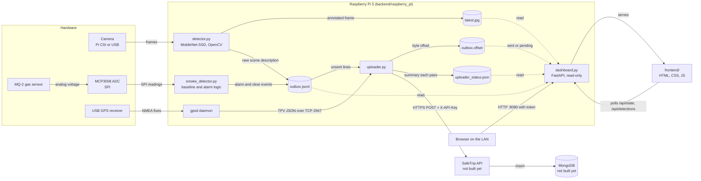
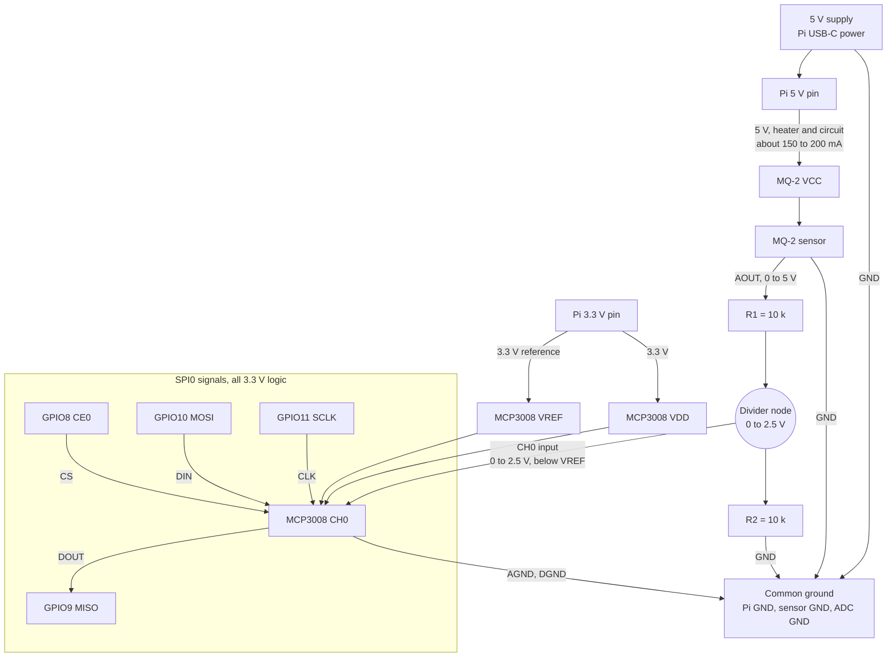

# SafeTrip design diagrams

Two views of the system:

1. [Component interactions](#1-component-interactions): how the software, sensors and services talk to each other.
2. [Voltage and wiring](#2-voltage-and-wiring): how each part is powered and how the 5 V sensor signal is brought down to the 3.3 V the Raspberry Pi accepts.

---

## 1. Component interactions

### Reading the diagram

- **Solid arrows** are data that moves between components.
- **Dotted arrows** are reads of a file or API that a component does not own.
- Only `detector.py` and `smoke_detector.py` write to `outbox.jsonl`. Only `uploader.py` writes the offset and status files. `dashboard.py` only reads, so a dashboard fault cannot stop detection or uploads.
- The camera is opened by one process only (`detector.py`). The dashboard shows the saved snapshot instead of opening the camera.
- The API and MongoDB are shown as planned components. The Pi side already produces the records they will receive.

---

## 2. Voltage and wiring

The Raspberry Pi GPIO and SPI pins are **3.3 V logic and are not 5 V tolerant**. The MQ-2 sensor needs 5 V and its analog output can reach about 5 V, so that output must be divided down before it reaches the ADC.

### Voltage rules the design depends on

| Point | Voltage | Why |
| --- | --- | --- |
| Pi 5 V pin to MQ-2 VCC | 5 V | The MQ-2 heater and circuit need 5 V. Draw this from the 5 V pin, never from a GPIO pin. |
| MQ-2 AOUT | 0 to about 5 V | Analog output follows the gas level. |
| Divider node (R1 and R2 at 10 k each) | 0 to 2.5 V | Halves the sensor output. Keeps the signal below the ADC input limit. |
| MCP3008 CH0 input | 0 to 2.5 V | Must stay between GND and VDD (3.3 V). With VREF at 3.3 V, the full scale is 3.3 V, so the reading tops out at about 775 of 1023. |
| MCP3008 VDD and VREF | 3.3 V from Pi 3.3 V pin | Sets the logic level and the ADC reference. |
| SPI lines (CLK, MOSI, MISO, CS) | 3.3 V | Pi GPIO is 3.3 V. The MCP3008 is also 3.3 V, so no level shifting is needed. |
| All grounds | 0 V reference | Share one ground between the Pi, the sensor and the ADC. Without it the readings are wrong. |

### Why the divider is required

- Without R1 and R2, the MQ-2 output (up to about 5 V) would be applied directly to the MCP3008 input. The ADC inputs must not exceed VDD + 0.3 V, which is about 3.6 V here. Exceeding it can damage the ADC and can also back-feed into the Pi through the SPI lines.
- The 10 k resistors draw only about 0.25 mA at 5 V, which the sensor can supply easily.
- The MQ-2 digital output (DO) is not connected. Its threshold is set by a potentiometer and is hard to tune, so the software compares against a clean-air baseline instead.

### Limits to check on the bench

- The Pi 3.3 V pin supplies a small current, and the MCP3008 draws only a few milliamps, so it is safe to power from 3.3 V.
- The MQ-2 heater is the largest load. It must come from the 5 V rail with adequate supply capacity. A weak USB-C supply can cause brown-outs or unstable readings.
- The MQ-2 needs a warm-up period before its readings are stable. `smoke_detector.py` waits for this before setting the baseline.
